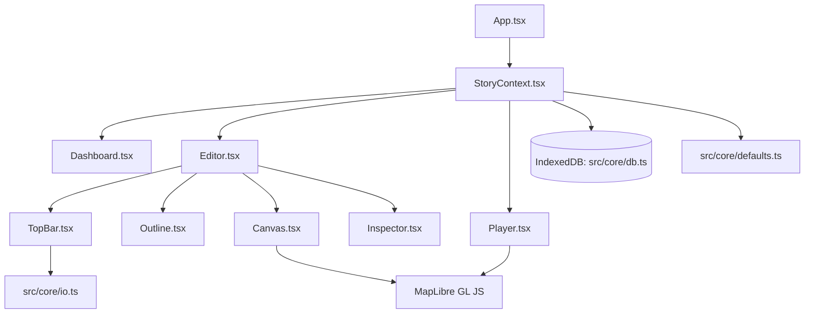

# Architecture Globale du Projet

Le projet StoryMap est structuré selon un modèle unidirectionnel articulé autour de React 18, du contexte React pour l'état, de MapLibre GL JS pour le rendu cartographique et d'IndexedDB pour la persistance locale dans le navigateur.

## Diagramme d'Architecture

## Flux de Données
1. **Initialisation** : L'utilisateur accède au tableau de bord (`Dashboard.tsx`). Les métadonnées des récits sont chargées depuis IndexedDB (`db.getAllStories()`).
2. **Édition** : Sélectionner un récit active le mode éditeur (`Editor.tsx`). Le contexte React charge la story complète et expose les méthodes de modification (`updateStep`, `updateStoryTitle`, `addStep`, `deleteStep`).
3. **Autosauvegarde** : Tout changement dans le contexte déclenche un minuteur de persistance automatique vers IndexedDB après 1,2 seconde d'inactivité.
4. **Lecture** : Le visualiseur plein écran (`Player.tsx`) synchronise les étapes textuelles avec des animations fluides de caméra MapLibre (`flyTo`).

